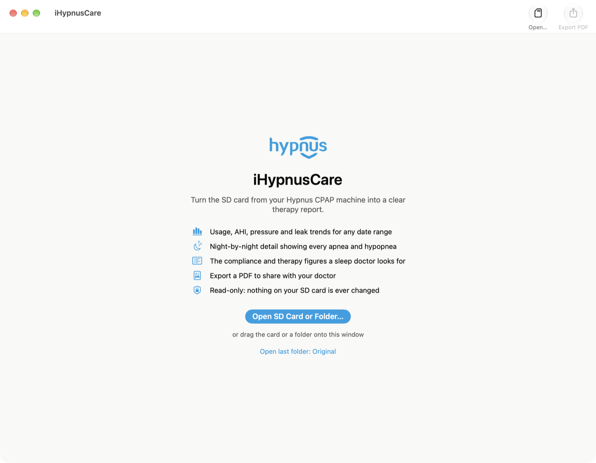
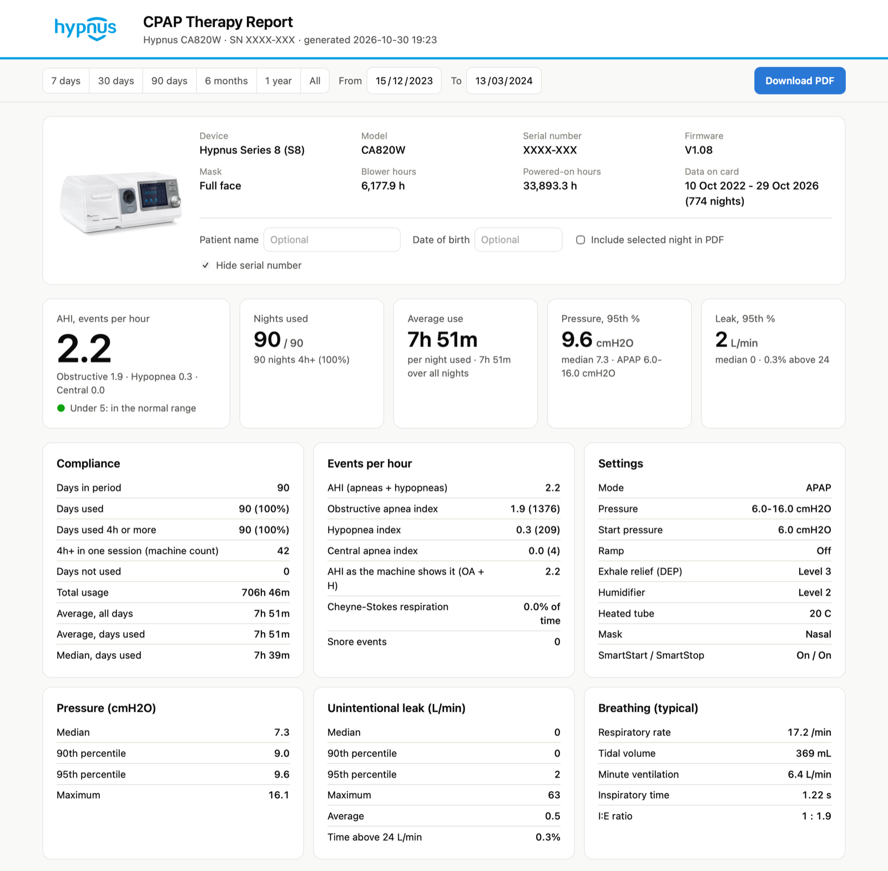
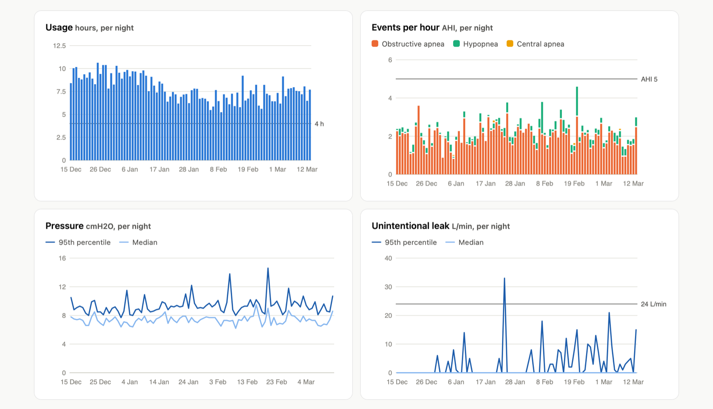
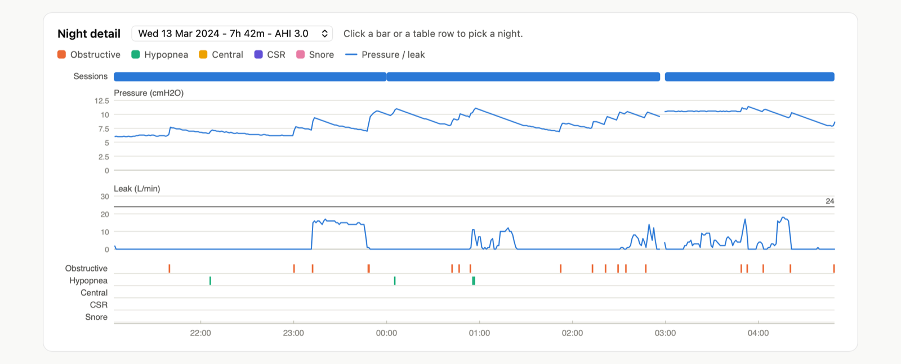
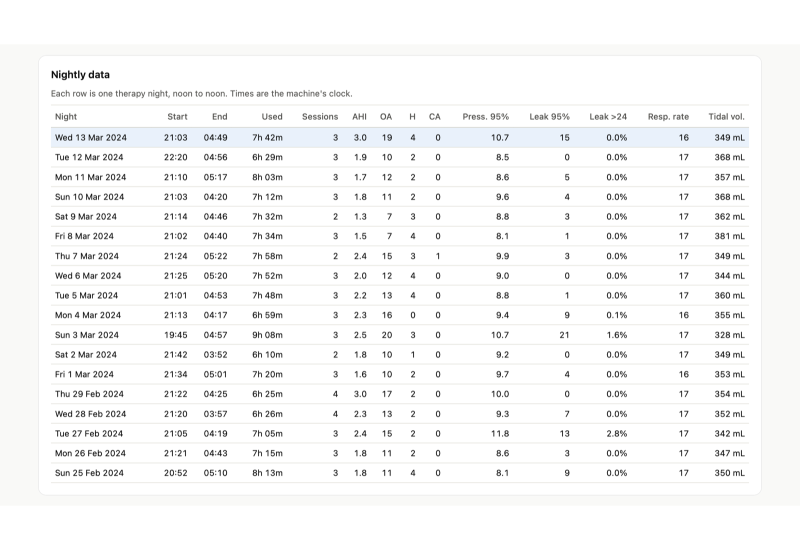

# iHypnusCare

**A Mac app that turns the SD card from a Hypnus Series 8 CPAP machine into a clear therapy report: compliance, AHI, pressure, leak, breathing and night-by-night detail, with PDF export for your doctor.**

> Unofficial. iHypnusCare is not made, endorsed or supported by Hypnus (Guangzhou Hypnus Healthcare). It isn't a medical device. The numbers come from decoding the machine's own data files, so check anything important with your clinician.

<p align="center"></p>

## Why

Hypnus machines record detailed data to their SD card, but the free tools most CPAP users rely on (like OSCAR) can't read it. The only official option is an old Windows program. iHypnusCare reads the card directly on a Mac.

## What it shows



- **Compliance:** days used, days with 4 h or more, average and median use, total hours. It also shows the stricter "one unbroken 4 h session" count that the machine's own screen uses.
- **Events:** AHI, plus obstructive, hypopnea and central indexes and event counts, Cheyne-Stokes time and snore events. It also shows the AHI the machine itself would display.
- **Settings in use:** mode, pressure range, start pressure, ramp, exhale relief, humidifier, heated tube, mask, SmartStart/Stop, and when they changed.
- **Pressure and leak:** median, 90th and 95th percentiles, maximum, and time above 24 L/min.
- **Breathing:** respiratory rate, tidal volume, minute ventilation, inspiratory time and I:E ratio. SpO2 and pulse appear too if an oximeter was attached.
- **Any date range:** 7 or 30 days through to all data, or pick exact dates. Long ranges switch to weekly or monthly bars.



**Night detail:** pick any night to see each session, the pressure and leak through the night, and the time of every apnea and hypopnea.



**Nightly table:** one row per night, with start and end time, hours, AHI and events, pressure and leak. Click a row to open that night.



**PDF export:** a clean multi-page PDF of the range you pick: summary and settings, trend charts, an optional night, and the nightly table. You can add a patient name and date of birth, which stay on your Mac. Tick **Hide serial number** before sharing screenshots or PDFs publicly.

*Screenshots show real data with the serial number hidden.*

## How it works

1. Open the app and click **Open SD Card or Folder…**, or drag the card (or a copy of it) onto the window or the Dock icon.
2. A progress bar shows how many folders and files have been read. A few years of data takes about 15 seconds.
3. The report opens inside the app. Change the dates, click any night, or choose **Export PDF** (⌘E).

The card is **only ever read**. Nothing on it is changed, and nothing is uploaded. PDF export downloads the jsPDF library from a CDN the first time you use it, so that step needs internet.

## Download

Get **[iHypnusCare-v1.10-macOS-universal.zip](https://github.com/LORDSn1per/iHypnusCare/releases/latest)** from the latest release, unzip it, and drag **iHypnusCare.app** to Applications. One download runs natively on both Apple Silicon and Intel Macs.

The app isn't signed with an Apple Developer ID, so macOS blocks it the first time. Open **System Settings → Privacy & Security** (on macOS 12 and older: **System Preferences → Security & Privacy → General**) and click **Open Anyway**, or run:

```bash
xattr -dr com.apple.quarantine /Applications/iHypnusCare.app
```

Or build it yourself from source (see [Build](#build)).

## Requirements

- **Apple Silicon:** macOS 11 Big Sur or later.
- **Intel:** macOS 10.14.4 Mojave or later. That covers most Macs from 2012 onwards (older Macs need a supported macOS, for example via OpenCore Legacy Patcher).
- **Python 3.8 or newer**, which reads the card:
  - macOS 10.15 and later: run `xcode-select --install` once for Apple's Command Line Tools, or macOS will offer to install them.
  - macOS 10.14 Mojave: install Python 3 from [python.org](https://www.python.org/downloads/macos/). The app also finds Python from Homebrew or MacPorts.
- For the best-looking report on macOS 10.14 and 10.15, keep Safari updated (Safari 14 or later), because the report uses the system's web engine.
- A Hypnus **Series 8** machine. Developed and tested with a CA820W APAP, firmware V1.08. Other Series 8 models (BA825, ST830, SV825) use the same card format, but their bilevel and ASV fields are less tested.

## Build

```bash
git clone https://github.com/LORDSn1per/iHypnusCare.git
cd iHypnusCare
tools/app/build_app.sh
open iHypnusCare.app
```

Building needs Apple's Command Line Tools (`swiftc`). The build compiles `tools/app/iHypnusCare.swift` (AppKit + WebKit, no Xcode project needed) into one universal binary (arm64 for macOS 11+, x86_64 for macOS 10.14.4+), bundles the Python reader and report template, and signs the app ad hoc for local use.

## Command line

The reader works without the app:

```bash
python3 -I tools/hypnus_report.py "/Volumes/NO NAME" --days 30 --nights        # text summary
python3 -I tools/hypnus_report.py "/Volumes/NO NAME" --html report.html --open  # full report in your browser
```

## The Hypnus card format

The card holds one folder per night of EDF-*like* files (an EDF-style 512-byte header, then binary records), plus a settings blob and a firmware log. The format was worked out from real card data and confirmed against Hypnus' own Windows viewer. [AGENTS.md](AGENTS.md) documents every file, record layout and setting offset, and explains how the machine's on-screen stats are calculated and cached back to the card.

## License

The code is released under the [MIT License](LICENSE). The license doesn't cover the Hypnus name, logo or device photo in `tools/assets/`.

## Disclaimer

For personal information only. Not for diagnosis or treatment decisions. "Hypnus" and the Hypnus logo are trademarks of their owner, used here only to identify compatible devices.
